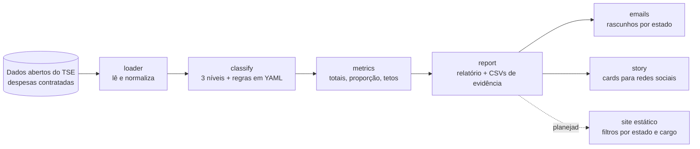

# Gastos de campanha com impulsionamento em plataformas estrangeiras

Quanto as campanhas eleitorais brasileiras gastam com **anúncios (impulsionamento) em plataformas estrangeiras** (Meta/Facebook e Instagram, Google/YouTube, X, TikTok)? Este projeto responde com dados públicos do TSE e deixa cada número conferível.

O objetivo é embasar uma discussão: **um teto percentual** para esse tipo de gasto nas campanhas, já que o dinheiro vai para empresas de fora do país. O projeto mede o problema; não julga a legalidade de nenhum gasto (impulsionamento é legal e declarado).

> **Status: em desenvolvimento.** O pipeline de análise e a geração de e-mails e de stories funcionam. O site público (filtros por estado e cargo) está **planejado**: veja [docs/site-e-publicacao.md](docs/site-e-publicacao.md).
> Os dados do TSE são **parciais** (prestação de contas em andamento) e os números mudam até a prestação final.

## Como funciona



1. O pipeline baixa o zip de prestação de contas do TSE (~209 MB) e lê as despesas **contratadas** dos candidatos.
2. Cada despesa é classificada em um nível: `confirmado` (cita a plataforma), `generico` (impulsionamento sem plataforma citada, contado como plataforma estrangeira porque não existe rede social nacional para isso), `provavel` (pista fraca, fora do número principal) ou `nenhum`.
3. O **número principal** é `confirmado + generico`; o `confirmado` aparece sempre como **piso**.
4. Cada execução grava uma pasta datada com relatório, CSVs por candidato e **as linhas de despesa que compõem cada número**, para qualquer pessoa conferir.

Detalhes em [docs/como-funciona.md](docs/como-funciona.md) e [docs/metodologia.md](docs/metodologia.md).

## Começando

Precisa de Python 3.10+ (o projeto usa 3.12):

```bash
python3.12 -m venv .venv
.venv/bin/pip install -e '.[dev]'
.venv/bin/pytest -q                     # os testes rodam offline
.venv/bin/gastos analisar --uf RN       # baixa os dados na primeira vez
```

A saída vai para `out/<data>_uf-RN/` (abra `relatorio.md`). Todos os comandos, opções e arquivos gerados estão em **[docs/uso.md](docs/uso.md)**.

Exemplo real (dados do TSE de 22/10/2026, Rio Grande do Norte, todos os cargos): R$ 4,24 milhões em plataformas estrangeiras, 4,6% de tudo que as campanhas declararam; piso confirmado de R$ 2,93 milhões.

## Estrutura do repositório

| Pasta | O que tem |
| --- | --- |
| `src/gastos/` | o código (loader, classify, metrics, report, emails, eleitos, links, story, cli) |
| `config/plataformas.yaml` | regras de classificação: fornecedores, palavras e gateways |
| `config/links_verificados.yaml` | mapeamento verificado para os links da prestação de contas |
| `templates/` | modelo do e-mail e das páginas de story (Jinja2) |
| `tests/` | testes automatizados, com dados de exemplo em `tests/fixtures/` |
| `scripts/` | utilitários, como `verificar_links.py` |
| `docs/` | documentação; `docs/superpowers/` guarda o desenho e o plano originais |
| `site/` | site estático (hoje só uma página provisória) |

Os dados baixados (`data/raw/`) e as saídas (`out/`, `divulgacao/`) **não** vão para o git.

## Limitações conhecidas

- **Dados parciais.** Reúnem prestações parciais, relatórios financeiros e algumas finais. Toda saída informa a data de geração dos dados e a da prestação mais recente.
- **Classificação validada à mão só no RN.** Em outros estados, confira o `qualidade.md` antes de usar os números. Há casos conhecidos de falso positivo (honorários de agência), descritos em [docs/metodologia.md](docs/metodologia.md).
- **Resultados do TSE incompletos** em alguns cargos na data da última coleta (por exemplo PB), o que afeta a lista de eleitos usada nos e-mails.
- Os links para a prestação oficial de cada candidato ainda **não estão verificados**.

## Quer ajudar?

Ajuda é muito bem-vinda, principalmente em validar a classificação em outros estados, no site e nos links. Veja o **[CONTRIBUTING.md](CONTRIBUTING.md)**.

## Princípios

- **Transparência:** todo número tem a lista de linhas que o sustenta; todo texto informa que os dados são parciais.
- **Sem acusação:** o corpo dos e-mails não cita candidatos nem partidos; o objetivo é a regra, não as pessoas.
- **Nada é enviado sozinho:** o projeto gera rascunhos; uma pessoa revisa e envia.
- **Dados públicos:** a fonte é o [portal de dados abertos do TSE](https://dadosabertos.tse.jus.br).

## Licença

[MIT](LICENSE): qualquer pessoa pode usar, copiar, modificar e distribuir o código, inclusive para evoluir o projeto. Os dados vêm do [portal de dados abertos do TSE](https://dadosabertos.tse.jus.br) e são públicos; ao usar os números, cite a fonte e informe que são dados parciais.
