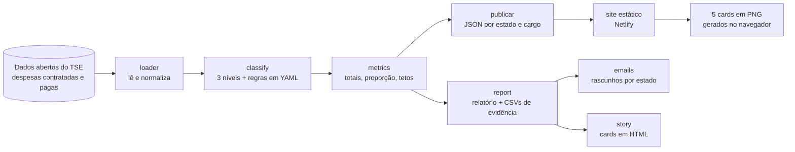

# Radar do Impulsionamento

**Quanto as campanhas gastam com anúncios em plataformas estrangeiras, e por que um teto faz sentido.**

Site: **<https://radar-impulsionamento.netlify.app>** (no ar desde 23/10/2026).

O projeto mede quanto as campanhas eleitorais brasileiras gastam com **anúncios (impulsionamento) em plataformas estrangeiras** (Meta/Facebook e Instagram, Google/YouTube, X, TikTok), com dados abertos do TSE, e deixa cada número conferível. O objetivo é embasar uma discussão: **um teto percentual** para esse tipo de gasto. O projeto mede o problema; não julga a legalidade de nenhum gasto (impulsionamento é legal e declarado).

> **Status: funcional.** O pipeline, o site (filtros por estado e cargo, maiores valores declarados e 5 cards para baixar em PNG), os e-mails e os stories funcionam. Os dados do TSE são **parciais** (prestação de contas em andamento) e os números mudam até a prestação final. Veja [as limitações](#limitações-conhecidas).

## Como funciona



1. O pipeline baixa o zip de prestação de contas do TSE (~209 MB) e lê as despesas **contratadas** dos candidatos (e as **pagas**, para medir a fonte do dinheiro).
2. Cada despesa é classificada em um nível: `confirmado` (cita a plataforma), `generico` (impulsionamento sem plataforma citada, contado como plataforma estrangeira porque não existe rede social nacional para isso), `provavel` (pista fraca, fora do número principal) ou `nenhum`.
3. O **número principal** é `confirmado + generico`; o `confirmado` aparece sempre como **piso**.
4. `gastos analisar` grava uma pasta datada com relatório, CSVs e **as linhas de despesa que compõem cada número**. `gastos publicar` grava os JSON que alimentam o site.

Detalhes em [docs/como-funciona.md](docs/como-funciona.md) e [docs/metodologia.md](docs/metodologia.md).

## Começando

Precisa de Python 3.10+ (o projeto usa 3.12):

```bash
python3.12 -m venv .venv
.venv/bin/pip install -e '.[dev]'
.venv/bin/pytest -q                     # os testes rodam offline
.venv/bin/gastos analisar --uf RN       # baixa os dados na primeira vez
.venv/bin/gastos publicar               # gera os JSON do site em site/data/ (~40 s, ~2 GB de RAM)
node --test tests/js/*.test.js          # testes do site (Node 22 ou mais novo)
```

Para ver o site localmente, sirva a pasta `site/` (por exemplo `python3 -m http.server -d site`) e abra `http://localhost:8000`.

A saída vai para `out/<data>_uf-RN/` (abra `relatorio.md`). Todos os comandos, opções e arquivos gerados estão em **[docs/uso.md](docs/uso.md)**.

Exemplo real (dados do TSE de 22/10/2026, Rio Grande do Norte, todos os cargos): R$ 4,24 milhões em plataformas estrangeiras, 4,5% de tudo que as campanhas declararam; piso confirmado de R$ 2,93 milhões. No país todo, o número principal é de cerca de R$ 438 milhões (9,3% do declarado).

## Estrutura do repositório

| Pasta | O que tem |
| --- | --- |
| `src/gastos/` | o código (loader, classify, metrics, report, publicar, emails, eleitos, links, story, cli) |
| `config/plataformas.yaml` | regras de classificação: fornecedores, palavras e gateways |
| `config/links_verificados.yaml` | mapeamento verificado para os links da prestação de contas |
| `templates/` | modelo do e-mail e das páginas de story (Jinja2) |
| `tests/` | testes automatizados em Python, com dados de exemplo em `tests/fixtures/`; `tests/js/` tem os testes do site (Node) |
| `scripts/` | utilitários, como `verificar_links.py` |
| `docs/` | documentação; `docs/superpowers/` guarda o desenho e o plano originais |
| `site/` | o site estático: `index.html`, `app.js`, `lib.js`, `style.css`, `vendor/` (html2canvas) e `data/` (JSON gerados por `gastos publicar`) |
| `netlify.toml` | publica a pasta `site/` na Netlify, sem build |

Os dados baixados (`data/raw/`) e as saídas (`out/`, `divulgacao/`) **não** vão para o git.

## Limitações conhecidas

- **Dados parciais.** Reúnem prestações parciais, relatórios financeiros e algumas finais. Toda saída informa a data de geração dos dados e a da prestação mais recente.
- **Classificação validada à mão só no RN.** Em outros estados, confira o `qualidade.md` antes de usar os números. Há casos conhecidos de falso positivo (honorários de agência), descritos em [docs/metodologia.md](docs/metodologia.md).
- **Resultados do TSE incompletos** em alguns cargos na data da última coleta (por exemplo PB), o que afeta a lista de eleitos usada nos e-mails.
- **Estados fora do RN são estimativas.** A checagem automática por estado (veja [docs/metodologia.md](docs/metodologia.md#validação-por-estado-checagem-automática)) dá confiança, mas não substitui a revisão linha a linha.
- Os links para a prestação oficial de cada candidato ainda **não estão verificados**; o site aponta para o portal de consulta do TSE.
- **O site cita pessoas:** lista os 5 maiores valores declarados por recorte, pelo nome, sem partido. É uma lista de valores declarados, não de irregularidades; erros podem ser reportados em [issues](https://github.com/ramondomiingos/gastos-impulsionamentos-eleicoes/issues).

## Reportar um erro

Encontrou um número, um nome ou um texto errado no site ou nos dados? **Avise, é a ajuda mais valiosa.**

1. Abra o formulário: **[Reportar erro nos dados ou no site](https://github.com/ramondomiingos/gastos-impulsionamentos-eleicoes/issues/new?template=reportar-erro.yml)** (é preciso ter conta no GitHub).
2. Cole o **endereço da página** que você estava vendo (ele já guarda o estado e o cargo, por exemplo `#PB/governador`) e diga o que está errado e, se souber, qual seria o correto, com um link de fonte.
3. A issue recebe automaticamente a etiqueta **`erro-de-dados`**. Quem mantém o projeto avalia, corrige o quanto antes e registra a correção no histórico do repositório.

Não inclua dados pessoais (CPF, telefone, e-mail pessoal). Antes de reportar um gasto classificado errado, vale ler a [metodologia](docs/metodologia.md): ela explica o que o método conta e os casos já conhecidos. Se você não tem conta no GitHub, ainda não há outro canal público de correção; ele será indicado na seção "Quem faz e como pedir correção" do site assim que existir.

Etiquetas das issues: `erro-de-dados` (algo está incorreto), `feature` (ideia de funcionalidade), `question` (decisão em aberto), `help wanted` e `good first issue` (onde ajudar).

## Quer ajudar?

Ajuda é muito bem-vinda, principalmente em validar a classificação em outros estados, no site e nos links. Veja o **[CONTRIBUTING.md](CONTRIBUTING.md)**.

## Princípios

- **Transparência:** todo número tem a lista de linhas que o sustenta; todo texto informa que os dados são parciais.
- **Sem partido, linguagem neutra:** nenhum texto nem dado do site traz o partido do candidato (um teste garante); a lista se chama "Maiores valores declarados". Os e-mails nem citam nomes no corpo; o objetivo é a regra, não as pessoas.
- **Nada é enviado sozinho:** o projeto gera rascunhos; uma pessoa revisa e envia.
- **Dados públicos:** a fonte é o [portal de dados abertos do TSE](https://dadosabertos.tse.jus.br).

## Licença

[MIT](LICENSE): qualquer pessoa pode usar, copiar, modificar e distribuir o código, inclusive para evoluir o projeto. Os dados vêm do [portal de dados abertos do TSE](https://dadosabertos.tse.jus.br) e são públicos; ao usar os números, cite a fonte e informe que são dados parciais.
